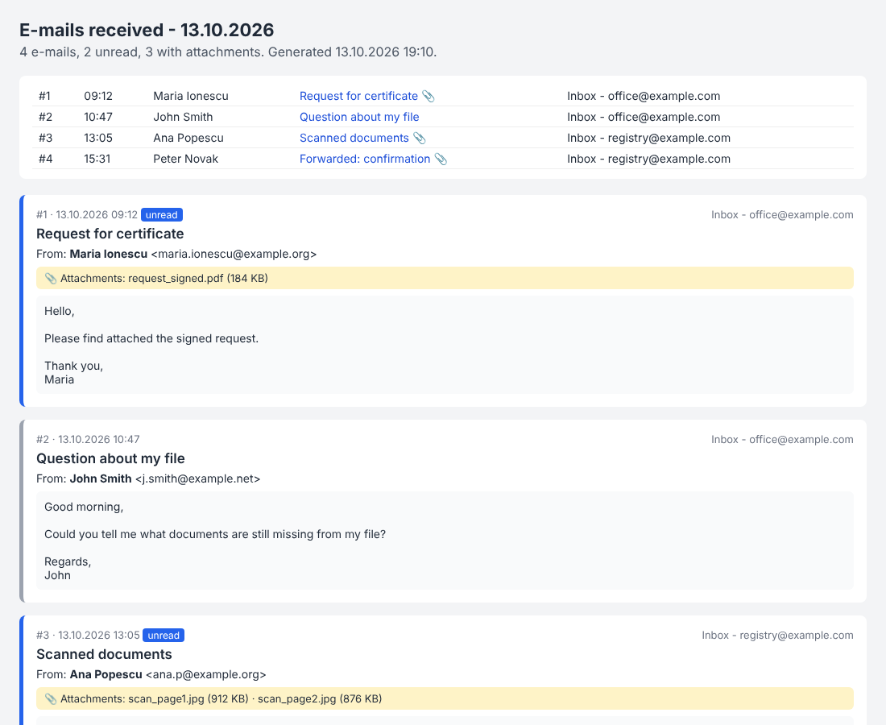

# Outlook Mail Assistant

A menu-driven **PowerShell** tool for desk work with busy mailboxes: it builds a daily
report of every e-mail received, prints attachments one by one after asking, and
prepares replies from ready-made templates.

It reads **Outlook**, **Gmail**, **Yahoo** or **any IMAP mailbox**, a **folder of saved
`.eml` files**, or **Thunderbird** mail folders. You can combine them in one report.

It was built for **locked-down office PCs**. It needs only what Windows already has: no
installs, no admin rights, no Python and no modules.

> Built from a real-world back-office workflow and published here in a generic form.
> The screenshot and the demo use fictitious e-mails only.



## What it does

| Menu | What happens |
|---|---|
| **1. Report** | Reads the chosen day's e-mails from every mailbox you set up. Creates an **HTML report** with a table of contents, sender, subject, body, attachments and unread flag. Also creates an **Excel file** with filters. Delivery receipts are skipped. Nothing changes in the mailbox: e-mails are not even marked as read. |
| **2. Print attachments** | Walks through the day's attachments and asks for each one: **P**rint / **N**o / **V**iew / **S**kip e-mail / **Q**uit. Signature images are ignored. Attached Outlook e-mails (`.msg`) are printed in a background job with a timeout, so a hanging Outlook cannot freeze the tool. |
| **3. Reply** | Lists the day's e-mails, shows the chosen one, and builds a reply from a numbered **template** or your own text, with greeting and signature. Every reply is logged to CSV and Excel. See the table below for where drafts are saved. |
| **5. Demo** | Generates the HTML report from fictitious e-mails. No mailbox needed. |
| **6. Set up mailboxes** | Adds or removes mailboxes and tests the connection. |

### Mail sources

| Source | How it is read | Replies |
|---|---|---|
| **Outlook** (desktop) | Every mailbox in the local Outlook profile, through Outlook itself. | Draft in Outlook. Sent from the mailbox the e-mail arrived in. |
| **Gmail, Yahoo, other IMAP** | Built-in IMAP client over TLS. The folder is opened **read-only**, so nothing is marked as read. | Draft goes into the mailbox's **Drafts** folder. Can also be sent through SMTP. |
| **Folder of `.eml` files** | Any mail program can save messages as `.eml`: drag them to a folder, or use an export. | Draft saved as an `.eml` file that opens as a new message. |
| **Thunderbird** | Reads its mail files directly. Setup finds them automatically. | Same as the `.eml` folder. |

The e-mail format (MIME) is decoded by the script itself:

- multipart messages and HTML-only messages;
- base64 and quoted-printable encodings;
- encoded headers and international file names;
- legacy charsets such as Windows-1250.

## Safety by design

- **Read-only towards the mailbox.** It never deletes, moves or flags anything.
- **Nothing is sent without asking.** Drafts are the default. Sending needs typing `YES`.
- **Passwords are never stored in plain text.**
  - Mail-account passwords are encrypted with Windows DPAPI. Only the same Windows user on the same PC can read them.
  - Gmail and Yahoo use **app passwords**, not the main password.
  - A rejected password is deleted at once.
- **No spreadsheet formulas from e-mails.** Values written to Excel are protected against formula injection.
- **Personal data stays out of the repository.** `config.json`, saved passwords and all generated reports are excluded by `.gitignore`.

## Getting started

1. Download the repository (green **Code** button → **Download ZIP**) and unzip it.
2. Double-click **`Start.bat`**.
3. With Outlook on the PC, choose **1**. Otherwise choose **6** first and add your mailbox.

To try it without any mailbox, choose **5 (Demo)**, or run:

```powershell
powershell -NoProfile -ExecutionPolicy Bypass -File OutlookMailAssistant.ps1 demo
```

Reports are written to the `Reports` folder next to the script.

### Gmail and Yahoo

Both need an **app password**, which requires 2-step verification on the account:

- **Gmail:** Google Account → Security → 2-Step Verification → App passwords.
- **Yahoo:** Account info → Account security → Generate app password.

Choose **6 → 2 (Gmail)** or **6 → 3 (Yahoo)**, then enter the address and the app password. The connection is tested right away.

Personal Outlook.com accounts accept only Microsoft sign-in (OAuth) for IMAP. Read them through the Outlook desktop app instead.

### Requirements

- Windows with Windows PowerShell 5.1 (built in).
- Microsoft Outlook (desktop) – only for the Outlook source.
- Microsoft Excel – optional, only for the `.xlsx` files.

## Configuration (`config.json`)

Option 6 writes this file for you. It can also be edited by hand; see
[`config.example.json`](config.example.json).

```json
{
  "Sources": [
    { "Type": "outlook" },
    { "Type": "imap", "Name": "Gmail - office@example.com", "Host": "imap.gmail.com", "Port": 993,
      "User": "office@example.com", "Address": "office@example.com",
      "SmtpHost": "smtp.gmail.com", "SmtpPort": 587 },
    { "Type": "folder", "Name": "Saved e-mails", "Path": "C:\\Mail\\Saved" },
    { "Type": "mbox", "Name": "Thunderbird", "Path": "C:\\...\\Thunderbird\\Profiles\\xxxx.default\\Mail\\Local Folders\\Inbox" }
  ],
  "Signature": "Your Name / Department",
  "Templates": { "1": "Please send the missing document as soon as possible." }
}
```

Optional IMAP keys:

- `Folder` (default `INBOX`);
- `DraftsFolder` (found automatically);
- `SmtpUser`.

## Tech

- PowerShell 5.1/7 with Outlook and Excel COM automation.
- Hand-written IMAP client over `SslStream`: literals, `EXAMINE`, `BODY.PEEK`, `APPEND` and modified UTF-7.
- SMTP with STARTTLS.
- MIME parser: RFC 2045/2047/2231 and 5322 dates.
- Streaming mbox reader.
- DPAPI for passwords.
- HTML/CSS report and CSV/Excel logging.
- Dependency-free test script, run by GitHub Actions together with PSScriptAnalyzer.

## Tests

```powershell
powershell -NoProfile -ExecutionPolicy Bypass -File tests\Run-Tests.ps1
```

71 checks run without Outlook or a network. They cover:

- e-mail decoding, including charsets, encoded headers and attachments;
- `.eml` folders and Thunderbird files;
- the IMAP protocol parser and reply e-mails;
- configuration, Excel protection and the demo report.

The IMAP and SMTP code was also tested end to end against TLS test servers.

## Limitations

- Outlook `.msg` files are read only through Outlook. For a folder source, save e-mails as `.eml`.
- Thunderbird keeps only headers for IMAP messages that were never downloaded. For full offline copies, turn on "Keep messages for this account on this computer".
- Sending works over SMTP port 587 (STARTTLS).

## License

MIT
